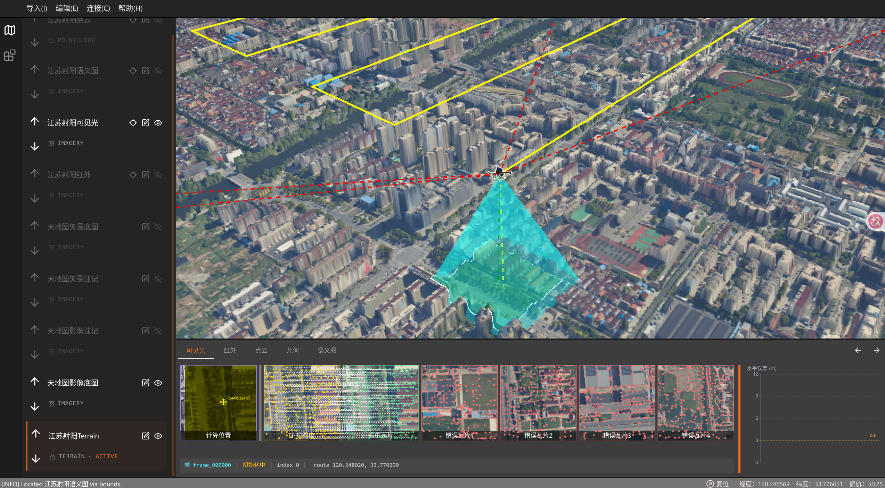

## 阶段性总结和一些小想法

本篇写于2026年11月16日，主要是本人对于近期事务的一些总结，还有一些新的想法。

### 近期总结

啊哈，最近真是忙啊，横向课题一堆破事堆积成山，又是写标书（虽说这个主要不是我写的），又是做Demo↓，又是上课，又是开一大堆会——累死。

做这个匹配定位Demo可把我愁坏了，突然要的非常急，工作量又非常大。

我真搞不懂这甲方，明明项目都还没开始，也没开始招标，甚至很多文书都还没有写完，就什么都要看，什么技术都要问，虽然我能理解这说明他们很担心而且是想做成事的，但是也总给我一种想要空手套白狼的感觉。

老师和甲方画饼，甲方要实现，实现就交给我，最后活全都变成我的工作了💢

更何况我的手头上什么都没有——没有数据，没有帮手，没有时间，这简直是难为人。光是写这些cesium和vue的页面还好，但是自己找数据自己处理真的是花了我很久的时间。从航片自己生成DOM和DEM和三维模型、自己写程序生成航线、自己调用模型处理数据、自己制定接口格式和数据结构、自己切片地图转换格式、自己部署地图瓦片服务器、自己写整个cesium页面的动画逻辑......

要不是因为我的平台之前就写了一部分，这个工作量是根本不可能写完的。

可是一想到这些东西写了只是为了看一眼然后丢掉，我就很气愤，毫无意义的工作——每天要写十几个小时的代码，就为了弄出来这么一个看一眼然后丢掉的东西。

感觉自己真是老了，才一两周这样强度的加班，这几天早上起来浑身就没力气，从前明明一两个月都能干下去。这几天早上起来感觉自己的身体已经在抗议了，浑身酸痛无力。

这是一种肉体上的疲惫，和精神上的疲惫还不太一样。应该是高强度的工作导致神经过度处于兴奋状态，最后存储的神经递质耗尽，神经系统产生了疲劳？之前我在本科的时候，也有过这种感受。从前一般给自己放假一段时间什么都不做过个三四天就能恢复过来了，万幸的是休息了两天，现在感觉好很多了。

---

说来，最近买来了一本叔本华的《人生的智慧》这本书来看，这本书取自于他的晚年著作《附录和补遗》。小小的一本书其实也不多，只有两百来页。

虽然迫于上周太忙了只看了前几章，但是**这本书却让我对叔本华有了极大的改观。**

从前我以为叔本华的哲学就是悲观和禁欲哲学，毕竟他的名句，大概就是这样的意思：“人生就像钟摆，在痛苦和无聊之间来回摆动，欲望得不到满足就是痛苦，得到了满足就很快变得无聊，所以人要禁欲。”

这听起来真的很像厌世哲学家，毕竟叔本华对于普通人的态度就是——绝大多数人都是浑浑噩噩的毫无意义的过完一生，但是这本书后面补充的那些让我开始重新审视这些言论。

> “常人的生活引向浑噩、呆滞，因为他们的全部心理都是涉及他们的个人安逸的那些渺小利益，因此用于应付各种各样的厄苦、困顿。所以，一旦他们停止为这些目标操劳，并且不得不返回他们的自身内在时，那难以忍受的无聊就向他们袭来。”
>
> “一个精神丰富的人完全在孤身一人的时候，沉浸于自己的精神世界，自得其乐；但对于一个呆滞、麻木的人，接连不断的变换着聚会、看戏、出游、消遣都无法驱走那折磨人的无聊。”
>
> “如果一个人能够享有自己卓越的、与众不同的精神个性所带来的乐趣，那么，对于他来说，普通大众所追求的大部分乐趣都是纯属多余的，甚至只是烦恼和累赘。”
>
> “人的精神思想财富越优越和显著，留给无聊的空间就越小。”
>
> “我们大致上可以发现：一个人对于人的交往的热衷程度，与他贫乏的思想和总体的平庸成正比。**人们在这个世界上要么选择独处，要么选择庸俗，除此之外，再没有更多别的选择了。**”
>
> “一个内心丰富的人对于外在世界确实别无他求，除了这一否定特性的礼物——闲暇。他需要闲暇去培养和发展自己的精神才能，享受自己的内在财富。这样，他的要求就是在自己的一生中，每天每时都可以成为自己。当一个人注定要把自己的精神印记留给整个人类，那么，对这个人只有一种幸福或者一种不幸可言，那就是能够完美发掘、培养自己的才能，得以完成自己的杰作，或者受到阻挠而不能这样做。除此之外，所有其他的别的对于他来说都是无关紧要的。”

虽然其中有些话包含了一些批评常人的态度，但仔细想来，我不得不的承认这些话是正确的。甚至某些程度上，我自己的社交和经历也正印证了这些话吧。

**与我而言也是同样的，我喜欢闲暇，闲暇是我创造自己的作品的最大的动力，写文章也好，做项目也罢，不是为了去证明什么，也不是为了博取金钱和名利，只是因为我享受这样的尽情绽放自己的过程吧。**

大抵我也终于能够说服自己，接受自己的特殊个性，接受自己不像大家一样出去聚餐，接受自己对所有的娱乐都不感兴趣，接受自己沉浸在自己的世界里了。

### 新想法💡

有时候感觉我像个灾星一样，用什么AI，那个AI就算力不足要收紧政策了。

之前用过一段时间GPT，但免费的GPT现在已经只能聊几句而且变得极其呆板了。之后切换到了Gemini，然后前段时间Gemini也放弃了免费用户，只留了一个很基础很白痴的模型给用。然后我又切换到了Deepseek，结果前几天ds也因为算力不足，给免费用户设置了限额。

虽然我对于AI的要求不是那么高，因为很多事情我都喜欢亲力亲为，但是这些信号无疑也在说明一些事情。

明明算力价格这些年来看是一直在下降，可是为什么算力缺越来越不够了呢？因为人越来越懒了。正如我前面所写的，人的大脑思考是极其耗能的，一旦有了偷懒的捷径，就会放弃思考。哪怕所面临的这任务，其实本来只是轻而易举的小事也一样。

**至少短期来看，算力在以后是只会越来越不足的，因为算力存在极限，而人的懒惰是无限的。**

我一直都反对agent那样的全代理式的保姆ai，自己至今也从来没用过，也没有为AI花过一分钱。我不需要AI有多么聪明，因为所有的写代码都是我亲自制定架构→我制定接口→我设计布局→我写模板或者范例。只有简单到我确信只是纯粹的工作量或者很常见的需求，我才会从聊天框里让AI编写代码。

这样的习惯让我受益至今，不过最近的这些政策收紧也让我思考了很多事情。

我决定要写一个自己的agent客户端——一个转为强控制和高追求开发者设计的受控coding专用agent。不过与其说是agent，不如说是根据我的习惯和标准，设计的一套ai开发工具软件吧。

这样的萌芽已经在我的心里产生了。